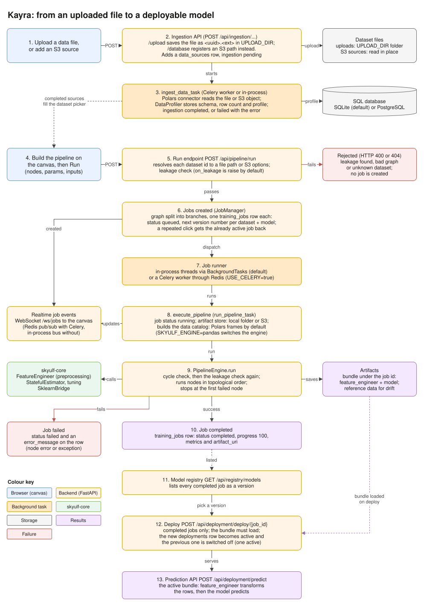

# Skyulf Architecture & Data Flow

## 1. The Dual-Engine Strategy: Polars & Pandas

Skyulf uses a hybrid approach to data processing to balance **performance** (Ingestion) with **compatibility** (Machine Learning).

### A. Ingestion & Preview (Polars)
*   **Engine:** [Polars](https://pola.rs/)
*   **Why:** Polars is significantly faster than Pandas for reading large files (CSV, Parquet) and performing initial scans. It uses lazy evaluation and multi-threading.
*   **Where:**
    *   `backend/data_ingestion/`: Reading uploaded files.
    *   `backend/services/data_service.py`: Generating data previews and samples for the UI.
*   **Format:** Data is kept in Polars DataFrames or converted to Python dictionaries (`to_dicts()`) for JSON API responses.

### B. Machine Learning Core (Numpy / Scikit-Learn)
*   **Engine:** [Numpy](https://numpy.org/) & [Scikit-Learn](https://scikit-learn.org/)
*   **Why:** The vast majority of the Python ML ecosystem (Scikit-Learn, XGBoost, LightGBM) requires raw Numpy arrays (matrices) to perform fast, C++ bound mathematics.
*   **Where:**
    *   `skyulf-core/`: The actual mathematical pipeline execution (e.g. Scikit-Learn Wrappers).
    *   `backend/ml_pipeline/execution/`: The orchestration layer running the nodes.
*   **Format:** Data is structurally maintained as Polars or Pandas depending on the caller, but strictly converted to Numpy arrays when hitting statistical/ML nodes via the `SklearnBridge`.

### C. The Bridge: SklearnBridge & Apache Arrow
*   **Technology:** `SklearnBridge` over [Apache Arrow](https://arrow.apache.org/)
*   **Role:** Arrow is the in-memory columnar format that both Polars and Pandas (2.0+) support.
*   **Benefit:** Instead of rigidly forcing one DataFrame type everywhere, the engine is dual-lane. If a Data Scientist passes Pandas, the `SklearnBridge` converts `Pandas -> Numpy`. If the ML Canvas uses Polars, the bridge converts `Polars -> Numpy`. Neither format wastes time converting into the other just to reach Scikit-Learn!

---

## 2. Training Job Lifecycle

[Editable draw.io source](assets/diagrams/architecture/job_lifecycle.drawio)

An upload is saved and registered first; a background ingestion task then profiles it with
Polars, and only completed sources appear in the canvas dataset picker.
Run sends the canvas graph to `POST /api/pipeline/run`, which checks for leakage before any job
exists, then creates one queued `training_jobs` row per branch.
Jobs run on in-process threads by default, or on a Celery worker through Redis when
`USE_CELERY=true`; either way `execute_pipeline` drives the engine, which calls skyulf-core.
A completed job shows up in the model registry as a version, and deploying it makes it the one
active deployment that the prediction API serves.

---

## 3. Future Architecture: The AI Hub

Skyulf is evolving from a Tabular ML tool into a multi-modal AI Hub.

### The "Node" Abstraction
The core architecture (Graph -> Nodes -> Artifacts) is agnostic to the data type.
*   **Today:** Nodes process `pd.DataFrame`.
*   **Tomorrow:** Nodes will process `ImageBatch`, `TextCorpus`, or `HuggingFaceDataset`.

### Planned Engines
We will introduce specialized engines alongside `PandasEngine` and `PolarsEngine`:
1.  **TorchEngine:** For Deep Learning workflows (PyTorch).
2.  **HuggingFaceEngine:** For NLP pipelines (Tokenizers, Transformers).
3.  **LlamaIndexEngine:** For RAG and LLM orchestration.

### Artifact Store Evolution
The `ArtifactStore` will evolve to handle:
*   **Large Blobs:** Storing images/audio directly or via S3 references.
*   **Model Weights:** Managing `.pt`, `.onnx`, and `.gguf` files efficiently.
*   **Vector Indices:** Storing FAISS/ChromaDB indices for RAG.

See `ROADMAP.md` for the detailed timeline.
